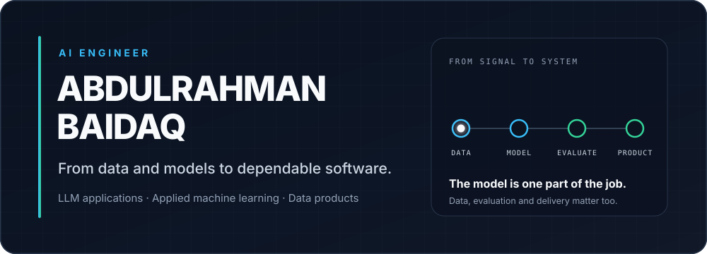
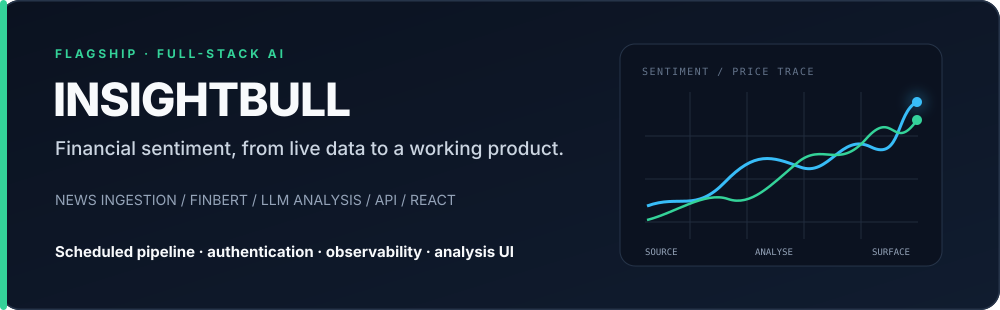
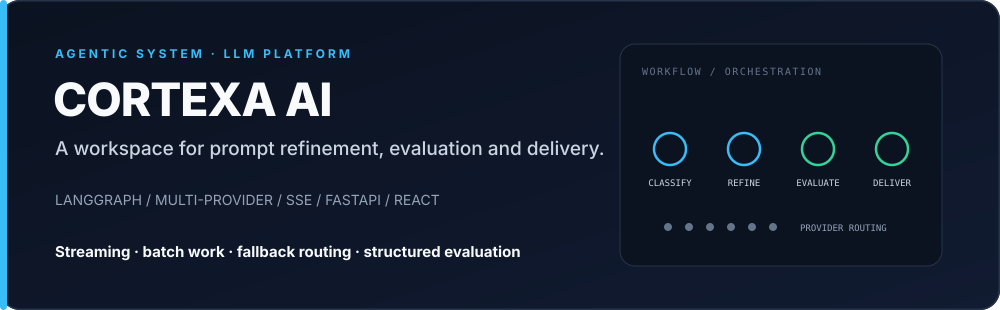
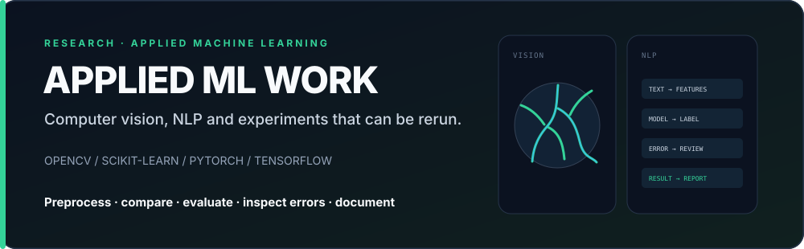
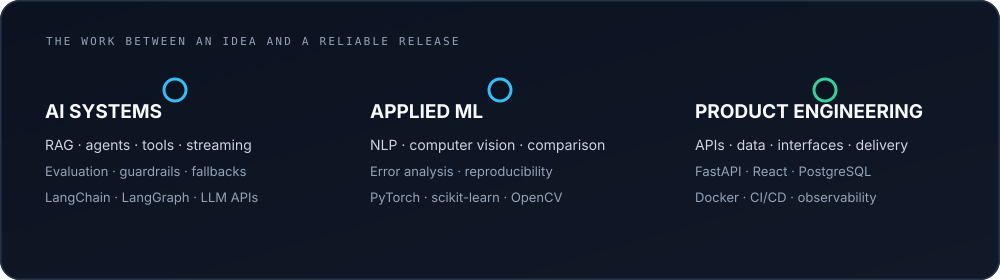

  

  <a href="https://linkedin.com/in/abdulrahmanbaidaq">LinkedIn</a>
  &nbsp;&nbsp;·&nbsp;&nbsp;
  <a href="https://github.com/Abood991B?tab=repositories">Repositories</a>

Hi, I'm Abdulrahman. I work on AI products across LLM applications, applied machine learning, and data engineering. I care about the less glamorous parts that make these systems useful: evaluation, failure handling, data quality, and the path from a notebook to a working interface.

## Work worth opening

**[InsightBull](https://github.com/Abood991B/insightbull)** is my most complete product build so far. It pulls market news from several sources, scores sentiment with FinBERT, adds LLM-assisted analysis, and brings the result into a React dashboard. I also built the scheduled pipeline, authentication, API, database layer, and operational controls around it.

I built **[CortexaAI](https://github.com/Abood991B/CortexaAI)** to explore whether prompt improvement could be treated as a repeatable workflow instead of a one-off chat. A LangGraph pipeline classifies, refines, and evaluates prompts while the application handles multiple model providers, streaming, batch work, and fallback routing.

Smaller research projects let me stay close to the mechanics of modelling and evaluation. That includes **[retinal vessel segmentation](https://github.com/Abood991B/retinal-vessel-segmentation)** with classical computer vision and **[mental-health text classification](https://github.com/Abood991B/Mental-Health-Status-Classification-from-Social-Media)** across traditional ML, neural networks, and transformers. Both are academic projects, not clinical or diagnostic tools.

## What I bring to a build

  

The tools change from project to project. The pattern does not: understand the data, decide how quality will be measured, build for failure, and make the result usable by someone other than the person who trained the model.

## Other projects

| Project | What I worked on |
| --- | --- |
| [Global Air Quality Dashboard](https://Abood991B.github.io/air-pollution-dashboard/) | Six connected D3 visualisations for exploring AQI patterns across countries, cities, and pollutants. |
| [Heart Disease Prediction](https://github.com/Abood991B/heart-disease-prediction-streamlit) | Exploratory analysis, class-imbalance handling, model comparison, and a Streamlit interface. Educational prototype; not medical advice. |
| [Apify Content Program Actors](https://github.com/Abood991B/apify-content-program-actors) | Practical web-data automation and structured content extraction. |

## Current focus

Right now, I'm most interested in the engineering around reliable LLM applications: grounded retrieval, agent coordination, evaluation, and the controls that keep a useful demo from becoming a fragile product.

## Contact

If you want to discuss an AI build, compare notes on evaluation, or ask about one of the projects above, the best place to reach me is [LinkedIn](https://linkedin.com/in/abdulrahmanbaidaq).
