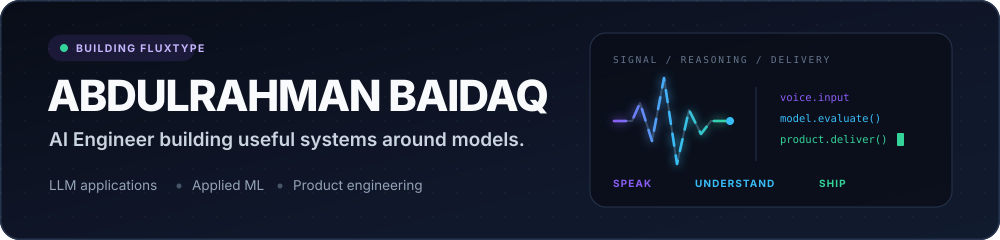
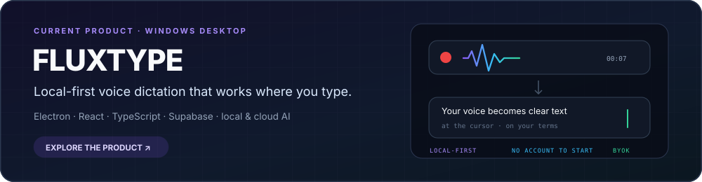
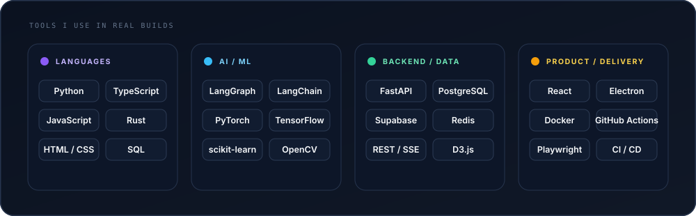
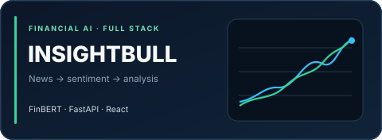
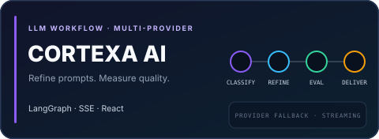
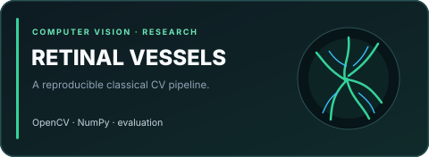
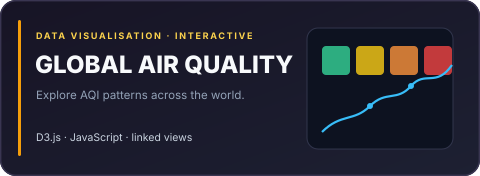
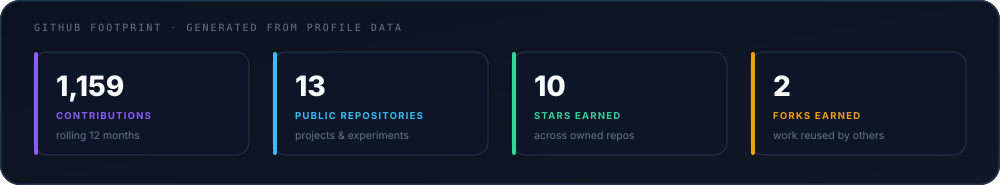

  

  <a href="https://fluxtype.app">FluxType</a>
  &nbsp;&nbsp;·&nbsp;&nbsp;
  <a href="https://linkedin.com/in/abdulrahmanbaidaq">LinkedIn</a>
  &nbsp;&nbsp;·&nbsp;&nbsp;
  <a href="https://github.com/Abood991B?tab=repositories">Repositories</a>

## About Me

I'm Abdulrahman, an AI engineer who likes owning the full path from an idea to working software. My projects sit across LLM applications, applied machine learning, data engineering, and the product work needed to make those systems useful.

- **Right now:** building [FluxType](https://fluxtype.app), a local-first voice dictation product for Windows.
- **How I work:** start with the data and evaluation criteria, then design for failure, maintenance, and delivery.
- **What interests me:** reliable agents, local AI, retrieval, model evaluation, and human-friendly AI interfaces.

## Building FluxType

[FluxType](https://fluxtype.app) turns speech into clear text inside standard Windows apps. It can transcribe locally, use explicitly selected cloud providers, apply optional formatting, and insert the result at the cursor. My work spans the Electron and React desktop experience, native Windows integration, model orchestration, offline-first settings, the release pipeline, and the supporting web and backend surfaces.

The product code lives in a private repository under the [FluxType organization](https://github.com/FluxType-app). GitHub can show the contribution count without exposing private code, repository names, or commit details.

## Technical Toolbox

  

## Selected Work

<table>
  <tr>
    <td width="50%" valign="top">
       
      <strong><a href="https://github.com/Abood991B/insightbull">InsightBull</a></strong> 
      Financial-news ingestion, FinBERT sentiment scoring, LLM-assisted analysis, and an interactive market dashboard.  
      <code>Python</code> <code>FastAPI</code> <code>React</code> <code>PostgreSQL</code>
    </td>
    <td width="50%" valign="top">
       
      <strong><a href="https://github.com/Abood991B/CortexaAI">CortexaAI</a></strong> 
      A graph-based workspace that classifies, refines, and evaluates prompts across multiple model providers.  
      <code>LangGraph</code> <code>FastAPI</code> <code>SSE</code> <code>TypeScript</code>
    </td>
  </tr>
  <tr>
    <td width="50%" valign="top">
       
      <strong><a href="https://github.com/Abood991B/retinal-vessel-segmentation">Retinal Vessel Segmentation</a></strong> 
      A reproducible classical computer-vision pipeline with preprocessing, parameter search, and annotated-mask evaluation.  
      <code>Python</code> <code>OpenCV</code> <code>NumPy</code> · Academic research, not a clinical tool.
    </td>
    <td width="50%" valign="top">
       
      <strong><a href="https://Abood991B.github.io/air-pollution-dashboard/">Global Air Quality Dashboard</a></strong> 
      Six connected visualisations for exploring AQI patterns across countries, cities, and pollutants.  
      <code>D3.js</code> <code>JavaScript</code> <code>Data visualisation</code>
    </td>
  </tr>
</table>

## GitHub Footprint

  

The contribution total includes anonymized activity from private repositories. The card is generated from GitHub data each week inside this repository, so it does not depend on a public stats service or expose private project details.

## More Work

| Project | Focus |
| --- | --- |
| [Mental Health Text Classification](https://github.com/Abood991B/Mental-Health-Status-Classification-from-Social-Media) | Comparing traditional ML, neural networks, and transformers for text classification. Academic research; not a diagnostic system. |
| [Apify Content Program Actors](https://github.com/Abood991B/apify-content-program-actors) | Web-data automation and structured content extraction. |
| [Heart Disease Prediction](https://github.com/Abood991B/heart-disease-prediction-streamlit) | Model comparison, class-imbalance handling, and a Streamlit interface. Educational prototype; not medical advice. |

## Let's Talk

If you're working on an AI product, model evaluation, local AI, or the engineering around reliable LLM applications, reach me on [LinkedIn](https://linkedin.com/in/abdulrahmanbaidaq). You can also explore [FluxType](https://fluxtype.app) or open any of the repositories above for implementation details.
