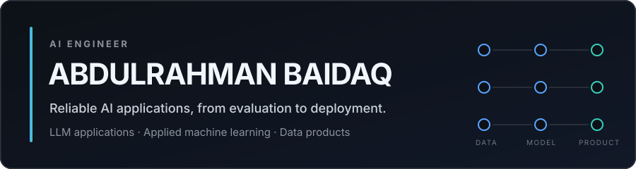

  

  I build applications around language models and machine learning, with an emphasis on evaluation, maintainable architecture, and complete paths from data to interface.

  <a href="https://linkedin.com/in/abdulrahmanbaidaq">LinkedIn</a>
  &nbsp;·&nbsp;
  <a href="https://github.com/Abood991B?tab=repositories">All repositories</a>

## Selected projects

### [InsightBull](https://github.com/Abood991B/insightbull)

`Python` `FastAPI` `React` `TypeScript` `FinBERT` `PostgreSQL`

A full-stack financial sentiment research platform that collects market news from multiple sources, combines transformer-based sentiment scoring with generative analysis, and presents the results alongside market data. The project includes scheduled ingestion, authentication, observability, and an interactive analysis interface.

### [CortexaAI](https://github.com/Abood991B/CortexaAI)

`Python` `FastAPI` `React` `LangChain` `LangGraph` `SSE`

A multi-provider prompt-engineering workspace built around a graph-based agent workflow. It supports prompt classification, expert refinement, structured evaluation, real-time streaming, batch processing, and provider fallback in a complete API and web application.

### [Retinal Vessel Segmentation](https://github.com/Abood991B/retinal-vessel-segmentation)

`Python` `OpenCV` `NumPy` `Computer vision`

A reproducible classical computer-vision pipeline for retinal vessel segmentation, with preprocessing, parameter optimisation, evaluation against annotated masks, and generated result reports. This is an academic image-analysis project, not a clinical tool.

### [Global Air Quality Dashboard](https://Abood991B.github.io/air-pollution-dashboard/)

`JavaScript` `D3.js` `Data visualisation`

An interactive data story for exploring air-quality patterns across countries, cities, pollutants, and AQI categories. Six connected visualisations turn a global dataset into a navigable analytical dashboard.

### Additional work

- [Mental Health Text Classification](https://github.com/Abood991B/Mental-Health-Status-Classification-from-Social-Media) — a comparative NLP workflow covering traditional machine learning, neural networks, transformers, opinion mining, and reproducible result generation. It is a research project, not a diagnostic system.
- [Heart Disease Prediction](https://github.com/Abood991B/heart-disease-prediction-streamlit) — an end-to-end classification project covering exploratory analysis, imbalance handling, model comparison, and a deployed Streamlit interface. It is an educational prototype, not medical advice.

## Technical focus

- **LLM applications:** retrieval-augmented generation, tool use, agent workflows, structured outputs, streaming, and evaluation
- **Applied machine learning:** NLP, computer vision, model comparison, error analysis, and reproducible experimentation
- **Product engineering:** Python, FastAPI, TypeScript, React, PostgreSQL, Docker, CI/CD, and observable data pipelines

## How I work

- Start with a measurable problem and make evaluation criteria explicit.
- Design for failure modes, reproducibility, and maintainability—not only the demo path.
- Build the full path from ingestion and modelling to APIs and usable interfaces.

## Current interests

I am currently focused on reliable LLM applications: grounded retrieval, agent coordination, evaluation, and the engineering needed to move model capability into dependable software.

## Contact

The best place to reach me is [LinkedIn](https://linkedin.com/in/abdulrahmanbaidaq). You can also explore the implementation details, documentation, and results in the repositories linked above.
