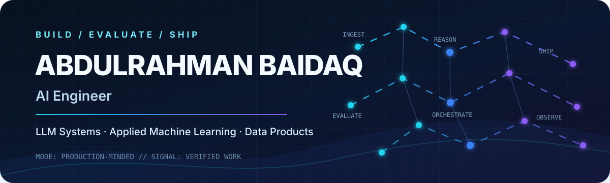
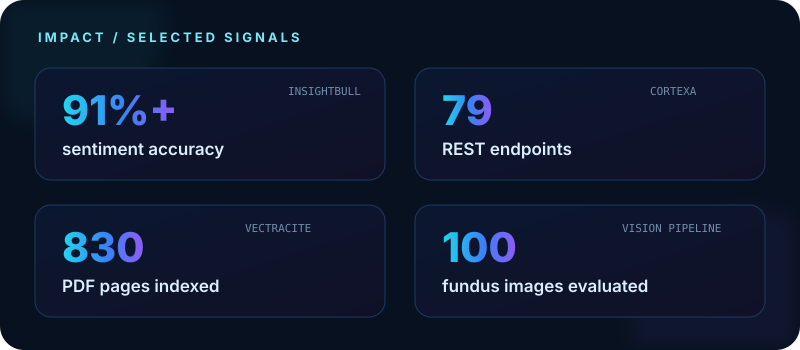
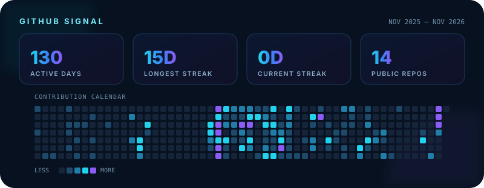

  

  

  
  

## 01 / IDENTITY

> **AI Engineer building useful systems beyond the notebook.** I work across LLM applications, agentic workflows, applied machine learning, and data products, with a focus on measurable outcomes, clear architecture, and maintainable delivery.

  

## 02 / TOOLCHAIN

> The stack I use to move from model idea to reliable product.

<strong>Languages & product engineering</strong>

  
  
  
  
  

<strong>AI, machine learning & orchestration</strong>

  
  
  
  
  
  

<strong>Retrieval, data & ingestion</strong>

  
  
  
  

<strong>APIs & delivery</strong>

  
  
  
  
  
  

<strong>MLOps, GPU & code quality</strong>

  
  
  
  
  

## 03 / FEATURED BUILDS

> Selected work, with the engineering signal made explicit.

  
  

  
  

  

<strong>Open the project evidence log</strong>

 

| Build | Engineering signal |
| --- | --- |
| [**InsightBull**](https://github.com/Abood991B/insightbull) | Hybrid FinBERT + Gemini financial sentiment platform with **91%+ accuracy**, five data sources, and an automated market-hours pipeline Python · TypeScript · CSS · HTML |
| [**CortexaAI**](https://github.com/Abood991B/CortexaAI) | Multi-agent prompt engineering across **six LLM providers**, a seven-node LangGraph workflow, SSE streaming, and **79 REST endpoints** Python · TypeScript · FastAPI · React |
| [**VectraCite AI**](https://github.com/Abood991B/vectracite-ai) | Table-preserving ingestion over **five real SEC filings (830 pages)**, hybrid BGE + BM25 retrieval with weighted RRF, adaptive cross-encoder reranking, and deterministic verification of every cited figure Python · FastAPI · Qdrant · Redis · Kubernetes |
| [**Retinal Vessel Segmentation**](https://github.com/Abood991B/retinal-vessel-segmentation) | Nine-stage classical vision pipeline evaluated on **100 fundus images** with **95.6% accuracy** Python · OpenCV |
| [**Heart Disease Prediction**](https://github.com/Abood991B/heart-disease-prediction-streamlit) | End-to-end modeling workflow with imbalance handling, model comparison, and a deployed Streamlit interface Python · Jupyter Notebook · Streamlit |
| [**Global Air Quality Dashboard**](https://Abood991B.github.io/air-pollution-dashboard/) | Interactive D3.js data story with six connected visualizations and a live GitHub Pages deployment JavaScript · HTML · CSS · D3.js |

## 04 / GITHUB SIGNAL

> Twelve months of building, measured rather than claimed.

  

## 05 / ENGINEERING FOCUS

> I am most interested in the layer where model capability becomes product reliability: grounded retrieval, agent coordination, evaluation, observable pipelines, and interfaces people can actually use.

  
  
  

Built around evidence, not decoration.

